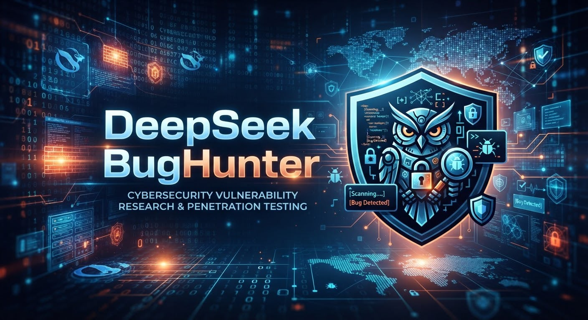

# DeepSeek BugHunter

**98 Agent Skills** for bug bounty research, web application security testing, external attack-surface assessment, validation, and reporting — designed to be loaded by Hermes Agent while using the model already selected in your Hermes profile (such as DeepSeek).

The bundle includes **58 `hunt-*` skills**, a broad set of recon and OSINT references, enterprise-platform assessment playbooks, smart-contract review material, reporting templates, and a deterministic engagement engine.

## What it does

- **Plan and scope:** organize targets, rules of engagement, and authorized assets before testing.
- **Recon:** discover and classify external assets, endpoints, parameters, technologies, and exposed information.
- **Hunt:** load class-specific techniques for issues such as IDOR, SSRF, SQL injection, XSS, OAuth, GraphQL, race conditions, and cloud misconfiguration.
- **Validate:** distinguish reproducible security impact from weak signals and false positives.
- **Capture and report:** preserve reproducible evidence, redact sensitive information, and prepare platform-ready reports.
- **Coordinate:** use engagement workflows, memory tools, and an optional deterministic engine for tracking and prioritizing work.

Skills are plain `SKILL.md` directories. Hermes Agent discovers skills from `~/.hermes/skills/`; each installed skill can also be invoked as a slash command, for example `/hunt`, `/recon`, `/triage`, or `/report`. Skills are loaded on demand, so the entire library does not need to be pasted into every prompt.

## Copy the skills into Hermes (Linux)

From the extracted repository directory on Linux:

```bash
mkdir -p ~/.hermes/skills
cp -a skills/. ~/.hermes/skills/
```


Start a new Hermes session after copying. This repository does **not** select a model, configure a provider, request an API key, or modify your Hermes profile. It uses the model and tools already configured in Hermes.

An optional copy-only helper is also included:

```bash
bash scripts/install.sh --dry-run
bash scripts/install.sh
```

The helper copies only the `skills/` directory to `~/.hermes/skills/`. It does not install Hermes, change model settings, or write credentials.

## Main skills and workflows

| Area | Examples |
|---|---|
| Methodology | `bb-methodology`, `bug-bounty`, `redteam-mindset` |
| Recon and OSINT | `offensive-osint`, `osint-methodology`, `web2-recon`, `recon-scope-triage` |
| Vulnerability classes | 58 `hunt-*` skills covering web and API bug classes |
| Enterprise assessments | `m365-entra-attack`, `okta-attack`, `enterprise-vpn-attack`, `vmware-vcenter-attack`, `cloud-iam-deep` |
| Mobile and supply chain | `apk-redteam-pipeline`, `ios-redteam-pipeline`, `supply-chain-attack-recon` |
| Smart contracts | `web3-audit`, `meme-coin-audit` |
| Validation and reporting | `triage-validation`, `evidence-hygiene`, `report-writing`, `bugcrowd-reporting` |
| Engagement workflows | `autopilot`, `hunt`, `recon`, `scope`, `surface`, `chain`, `intel`, `pickup`, `remember`, `memory-gc`, `token-scan`, `triage`, `validate`, `report` |

The full searchable catalog is in [`docs/skills.md`](docs/skills.md). For the recommended order of work, see [`USAGE.md`](USAGE.md).

## Optional deterministic tools

The repository also contains a Python CLI (`cbh`) and a deterministic engagement engine under `engine/`. They are separate from the skill-copy step and are not required to load or use the skills. Their optional commands and dependencies are documented in [`docs/cbh-cli.md`](docs/cbh-cli.md) and [`engine/README.md`](engine/README.md).

The engine delegates reasoning to the active Hermes CLI profile and uses its currently selected model and credentials. It does not configure providers or change model settings.

## Authorized-use boundary

Use these skills only for systems you own, explicitly authorized bug-bounty targets, contracted assessments, or controlled labs and CTFs. Confirm the exact scope and rules of engagement before sending traffic. Respect exclusions, rate limits, data-handling requirements, and stop conditions. Do not use the material for unauthorized access, disruption, credential abuse, persistence, or data extraction.

See [`SECURITY.md`](SECURITY.md) for the security policy and safe-use boundaries.

## Project files

- `skills/` — all 98 skill directories and their references, templates, and helper scripts.
- `commands/` — source workflow descriptions; their Hermes-facing forms are included as skills.
- `engine/` — scope-aware engagement orchestration and validation.
- `cbh/` — deterministic command-line utilities.
- `mcp/` — optional HackerOne MCP server.
- `scripts/` — copy helper, engagement scaffolding, skill validation, and index generators.
- `eval/` — local-lab evaluation harnesses and fixtures.
- `docs/` — methodology, architecture, skill catalog, and technical references.

## Licensing

Code is covered by the MIT license in [`LICENSE`](LICENSE). Skill and documentation content is covered by [`LICENSE-CONTENT`](LICENSE-CONTENT). Required attribution and change notes are collected in [`ATTRIBUTION.md`](ATTRIBUTION.md).
